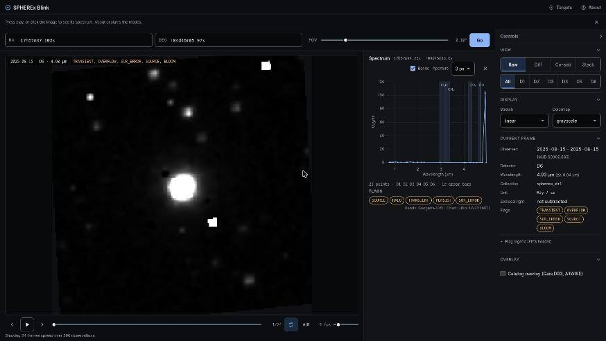
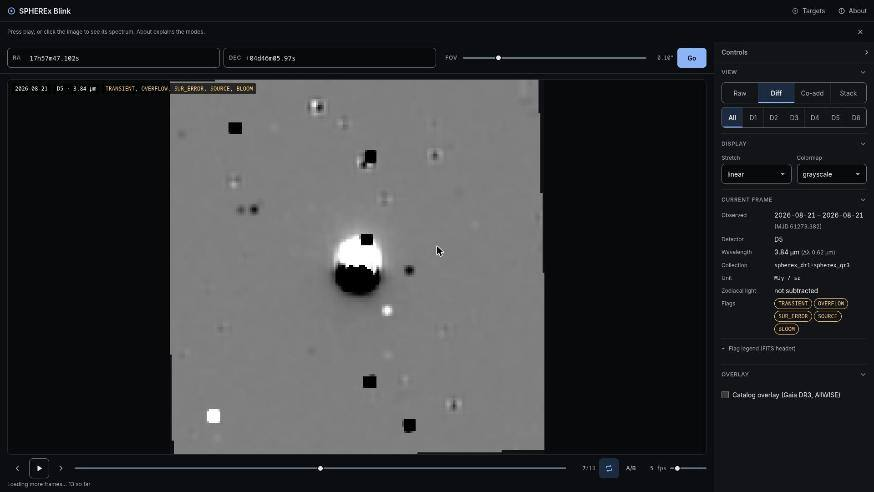
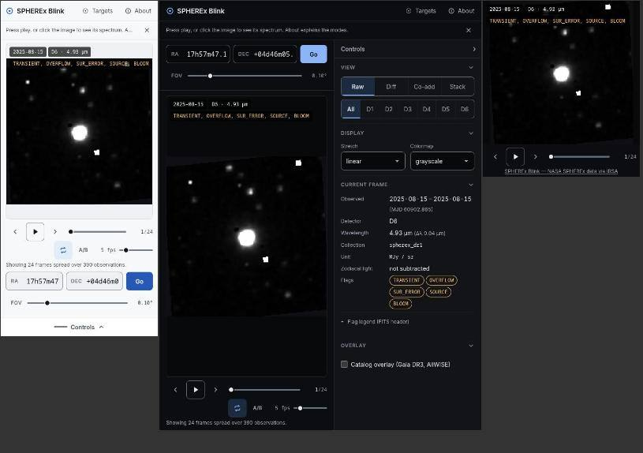

# SPHEREx Blink

A public web tool that turns the NASA SPHEREx spectral image archive into a
time-lapse: enter any sky position (RA/Dec) and watch the same patch of sky
across every SPHEREx epoch — the classic "blink comparator" technique that
found Pluto, applied to the newest all-sky infrared survey.

Built for the NASA Space Apps Challenge 2026, challenge
[Planet X and SPHEREx](https://www.spaceappschallenge.org/2026/challenges/planet-x-and-spherex/).







All screenshots above are real output of the running application on real
archive data (see [`docs/screens-real/`](docs/screens-real/) and
[`docs/live-results/`](docs/live-results/)).

## What it does

- **Time-lapse from live archive data.** Type RA/Dec (decimal or sexagesimal)
  and a field of view (0.01–0.5°); the backend queries IRSA with a SIA2 cone
  search (TAP fallback), downloads cutouts for every SPHEREx exposure
  covering the position, and streams them to the browser as float32 frames
  sorted by observation time. Playback 1–30 fps with play/pause, loop, frame
  scrubber and a two-frame blink comparator.
- **Like-for-like comparison modes.** `raw` (each exposure as observed),
  `diff` (later minus earlier epoch), `coadd` (inverse-variance mean) and
  `stack` (per-detector stacks). Frames are grouped by detector array (D1–D6)
  and wavelength so motion and faint sources show up against a stable
  background.
- **Click for a spectrum.** Clicking any pixel assembles a spectrum from
  every exposure covering it — aperture-averaged surface brightness per
  wavelength with 1σ error bars from the VARIANCE extension, molecular-ice
  band shading (H₂O, CH₄, CO₂, CO) and per-detector summaries.
- **Honest metadata.** Each frame shows observation time, detector, central
  wavelength, collection and flag badges (saturation, persistence, ghosts…)
  whose names come from the FITS `FLAGS` header legend itself, never
  hardcoded.
- **Catalog overlays.** Optional Gaia DR3 and AllWISE catalog markers via
  Aladin Lite (loaded on demand from a CDN with a fallback mirror; the app
  works fully without it).
- **Shareable state.** Coordinates and every display setting live in the URL,
  so a view can be linked or embedded in an iframe (`?embed=1`).
- **Mobile-first.** Responsive from 375 px to desktop and inside iframes;
  dark neutral theme, WCAG AA contrast, `prefers-reduced-motion` and
  `prefers-color-scheme` respected, full keyboard controls.
- **Offline demo mode.** `?mock=1` renders the entire UI from deterministic
  synthetic data — no backend or network needed (useful for demos and tests).

## The five presets

The targets named by the challenge are one click away (header **Targets**
menu or `GET /api/v1/targets`). Fast movers are stored at their position
propagated to epoch 2026.0 (the J2000 catalogue positions are up to ~4.4′ off
at SPHEREx epochs and would fall outside the field), and requests within
0.3″ of a preset snap to its exact coordinates so the baked cache always
hits:

| Preset | RA (epoch 2026.0) | Dec | FOV | Note |
|---|---|---|---|---|
| Barnard's Star | `17h57m47.102s` | `+04d46m05.97s` | 0.1° | Fastest proper-motion star; moves north across epochs |
| Epsilon Indi B | `22h04m23.201s` | `-56d48m02.34s` | 0.1° | Binary brown dwarf (~1.1″ apart), unresolved at SPHEREx's 6.15″/pixel; no reliable motion measurement |
| WISE 0855 | `08h55m02.344s` | `-07d14m31.86s` | 0.1° | Y dwarf — genuinely faint in SPHEREx (see Limitations) |
| RW Aurigae | `05h07m49.581s` | `+30d24m04.65s` | 0.05° | Young variable star |
| R Draconis | `16h32m40.136s` | `+66d45m18.09s` | 0.05° | Carbon star; saturates the core in many frames |

## Quick start

Prerequisites: Rust (stable), Node.js 20+ and npm. Docker is optional.

### Backend only (API on :8080)

```sh
cd backend
cargo run
# GET http://localhost:8080/api/v1/health
```

### Frontend dev server

```sh
cd frontend
npm ci
npm run dev          # Vite dev server; /api is proxied to localhost:8080
```

### Production-style local run (one binary serves everything)

```sh
cd frontend && npm ci && npm run build
cd ../backend && STATIC_DIR=../frontend/dist cargo run --release
# open http://localhost:8080
```

### Docker (single image, hosting-neutral)

```sh
docker build -t spherex-blink .
docker run --rm -p 8080:8080 spherex-blink
# open http://localhost:8080
```

### Offline demo (real data, zero network)

The image carries the five presets' data baked into `/data/cache`
(~30 MB, 455 files), so the demo never depends on IRSA being up:

```sh
docker run -d --name spherex-offline --network none spherex-blink
docker exec spherex-offline curl -s localhost:8080/api/v1/health
# all five presets answer from the baked cache; verified end to end
```

Measured with `--network none` on the final image: all five presets return
real frames, diff frames and spectra — see
[`docs/live-results/`](docs/live-results/). Without the baked cache the same
queries took ~1–13 minutes each through a slow, error-prone IRSA; from the
cache they answer in 0.2–3.7 s.

See [`docs/DEPLOY.md`](docs/DEPLOY.md) for the full environment-variable
table and per-host guides (VPS + Caddy, Render, Fly.io, Azure Container
Apps, Railway), plus the FortiGuard classification step for judges.

## URL parameters

Every view is a link. All parameters are validated; malformed values fall
back to defaults (never crash, never echo raw input back).

| Parameter | Values | Default | Meaning |
|---|---|---|---|
| `ra` | decimal deg or sexagesimal (`17h57m47.102s`) | — | Right ascension, `0 ≤ ra < 360` |
| `dec` | decimal deg or sexagesimal (`+04d46m05.97s`) | — | Declination, `-90 ≤ dec ≤ 90` |
| `fov` | `0.01`–`0.5` | `0.05` | Field of view, degrees |
| `mode` | `raw`, `diff`, `coadd`, `stack` | `raw` | Comparison mode |
| `stretch` | `linear`, `log`, `asinh`, `zscale` | `linear` | Display stretch |
| `cmap` | `grayscale`, `viridis`, `inferno`, `coolwarm` | `grayscale` | Colormap (`coolwarm` is diverging, suited to `diff`) |
| `fps` | int `1`–`30` | `5` | Playback speed |
| `frame` | int `≥ 0` | `0` | Initial frame index |
| `det` | int `1`–`6` | all | Restrict to one detector array |
| `embed` | `1` or `true` | off | Chromeless iframe mode (canvas + transport only) |
| `mock` | `1` | off | Synthetic data; no backend needed |
| `hint` | `1` | off | Force the first-visit hint to show |

Example — Barnard's Star blinking at 10 fps on the longest-wavelength
detector:
`?ra=17h57m47.102s&dec=%2B04d46m05.97s&fov=0.1&fps=10&det=6`

## How the data flows

1. **Search.** Each request runs a SIA2 cone search per configured
   collection (`spherex_dr1`, `spherex_qr3` — deduplicated, concurrent,
   ≤ 3 in-flight requests to IRSA with retry + backoff on 503/429). If
   SIA fails transiently the backend retries through the IRSA TAP
   service (`SIA_FALLBACK_TAP`).
2. **Cutouts.** By default the backend fetches only the needed byte
   ranges of each parent image from the public AWS Open Data mirror
   (`nasa-irsa-spherex` bucket) and rebuilds exactly the IBE cutout —
   verified bit-identical — because a full IBE cutout is ~4 MB of which
   ~97 % is an unused EPSF table. Any mirror error falls back to the
   real IRSA IBE cutout service.
3. **Caches.** Cutouts land in a weighted in-memory cache
   (`MAX_CACHE_MB`) and, when `CACHE_DIR` is set, on disk (cutouts never
   expire; search bodies refresh every `SEARCH_DISK_TTL_SECS`, served
   stale on transient upstream failure). Upstream failures are
   negative-cached briefly so a bad observation is not retried forever.
4. **Baked cache.** The Docker image ships the five presets' searches
   and cutouts under `/data/cache`, so the five demos answer with real
   data even with no network at all (verified with `--network none`).
5. **Frames.** A purpose-built, bounds-checked multi-extension FITS
   reader decodes IMAGE / VARIANCE / FLAGS / ZODI / WCS-WAVE (RICE_1
   tiles, TAN+SIP sky WCS, WCS-TAB wavelength tables) and reprojects
   each cutout onto a common north-up grid (4 samples per native pixel,
   capped at 192 px). A per-request deadline (default 40 s, soft
   deadline 8 s) returns partial results marked `truncated` rather than
   failing, and the frontend keeps polling while the cache fills.

## API

The Rust backend exposes a small JSON API (pixel data as row-major float32
little-endian, base64):

- `GET /api/v1/health` — service status and configured collections.
- `GET /api/v1/targets` — the five preset targets.
- `GET /api/v1/frames?ra=…&dec=…&fov=…&mode=…&detector=…&max_frames=…&subtract_zodi=…` —
  time series of cutouts, sorted by observation time.
- `GET /api/v1/spectrum?ra=…&dec=…&aperture_px=…` — spectrum at a sky
  position from all covering exposures.

The OpenAPI contract in [`shared/openapi-contract.json`](shared/openapi-contract.json)
is the single source of truth for requests, responses and error codes.

## Architecture

```
Browser (React, WebGL2 canvas, uPlot)         IRSA (NASA/IPAC)
        │  GET /api/v1/*                       ▲            ▲
        ▼                                      │ SIA2/TAP   │ AWS S3
axum API ──► validation ──► SIA2 cone search ──┘            │ byte-range
        (preset snap)           │                           │ cutouts
                                ▼                (IBE fallback)
                    memory + disk caches ◄──────────────────┘
                     (baked presets in the image)
                                │
                                ▼
                 FITS reader (MEF, RICE tiles, TAN+SIP WCS,
                 WCS-WAVE wavelength map, FLAGS legend)
                                │
                                ▼
              science layer: reproject → diff / coadd /
              stack / aperture spectrum → float32+base64
```

- **Backend** (`backend/`): Rust, axum + tokio. `#![forbid(unsafe_code)]`,
  typed errors, strict validation of every input (decimal and sexagesimal
  coordinates, FOV/mode/detector bounds). Bounded
  concurrency against IRSA, exponential backoff, per-request deadline with
  partial results, per-IP rate limit, gzip, CORS and a
  `frame-ancestors *` CSP so embedding works.
- **Frontend** (`frontend/`): Vite + React + strict TypeScript, no UI
  framework. WebGL2 renderer (R32F texture, stretch + colormap in GLSL)
  with a Canvas2D fallback; zod validation at every API boundary; uPlot
  for the spectrum chart (bundled); Aladin Lite loaded lazily behind an
  error boundary.
- **Deployment**: one container — the backend binary serves the built
  frontend and the API from a single origin ([`Dockerfile`](Dockerfile),
  [`docker-compose.yml`](docker-compose.yml), [`docs/DEPLOY.md`](docs/DEPLOY.md)).
  Non-root (uid 999), healthcheck, graceful stop (~130 ms); measured
  image 177.9 MiB with the baked cache, 139.5 MiB without.

## Verified results (real archive data, 2026-11-15)

Measured by end-to-end QA against the final image
([`docs/live-results/`](docs/live-results/), handoffs `b17`/`f10` in
`docs/vault/handoffs/`):

- **Proper motion is real and visible.** Barnard's Star moves north,
  about 9 arcsec per year in our simple centroid tracking (catalogue:
  10.4 arcsec per year); uncertainty about 2 arcsec per year. Diff mode
  shows it as a clean bright/dark dipole. Epsilon Indi B is a binary
  brown dwarf (about 1.1 arcsec apart), unresolved at SPHEREx's
  6.15 arcsec/pixel; a one-click preset, but we did not obtain a
  reliable motion measurement.
- **First frame from the baked cache: 0.29–0.74 s** (headless browser,
  all five presets; 0.2–3.7 s at the API). The same fields cold through
  a struggling IRSA took ~1–13 min during the bake.
- **Coverage per preset: 280–565 observations**, of which the API
  selects 24 frames spread across detectors D1–D6 and ~0.74–4.97 µm.
- **Tests:** 194 Rust tests, 250 frontend unit tests, 62 Playwright e2e
  tests (+ 2 opt-in `@live`), `cargo clippy -D warnings`, `cargo deny`,
  eslint and tsc all clean; 13-check container smoke test.

## Limitations (honest)

- **WISE 0855 is very faint and its motion is near the pixel-scale
  limit.** It is only 3–7σ at 3.1–4.6 µm in single frames, invisible
  below ~3 µm, and not detected convincingly in raw frames. Its motion
  (about 8 arcsec/yr, about 1.3 native pixels at 6.15 arcsec/pixel) is
  close to the pixel limit, so we could not measure it. The preset
  exists because the challenge asks to test it — the app says the truth
  rather than faking a detection.
- **R Draconis saturates.** Its core is flagged saturated and reads NaN
  in 12 of the 24 selected frames (all D4, most D2 and D3), so the
  centre spectrum is sparse there — a data limit the flag badges show
  honestly.
- **`diff`/`coadd` need comparable exposures** — the same detector at
  the same wavelength (within tolerance). Where the archive only has
  one epoch per band, those modes return few or no frames; that is a
  data limit, not an error.
- **IRSA is a shared public service and can be slow or unavailable.**
  We measured HTTP 502/503 outages and minutes-long responses; the
  deadline returns partial results and the demo image bakes the five
  presets so it works with `--network none`.
- **Coverage is the archive's.** SPHEREx releases do not cover the whole
  sky yet; positions without observations return "no observations".
  `truncated=true` is by design (a 24-frame selection out of hundreds
  of observations), not an error.
- **The spectrum is aperture photometry** assembled from archive cutouts
  (mean surface brightness per exposure/wavelength with propagated
  variance), not a pipeline-extracted calibrated spectrum; on fast
  movers the fixed-epoch aperture sees the source drift between bands.
- **The catalog overlay needs a CDN** at runtime (CDS first, jsDelivr
  fallback); on networks that block both it degrades gracefully and the
  viewer keeps working.
- **The cache is in-memory plus an optional disk directory**; it is
  per-instance (no sharing between replicas).

## Adding a new data release

No code changes needed — collections and the archive root are configuration:

```sh
IRSA_COLLECTIONS=spherex_dr1,spherex_qr3,spherex_dr2 \
IRSA_BASE_URL=https://irsa.ipac.caltech.edu \
cargo run --release
```

`IRSA_COLLECTIONS` is a comma-separated list queried in order (results are
deduplicated across collections). Everything else — timeouts, retries,
cache size, rate limits, cutout source, pre-warmed targets — is documented
in [`docs/DEPLOY.md`](docs/DEPLOY.md).

## Data sources and credits

- **NASA/IPAC Infrared Science Archive (IRSA)** — SPHEREx spectral images
  via the SIA2 and TAP services and the IBE cutout service
  (`spherex_dr1`, `spherex_qr3` collections); the same Level-2 files are
  read from the AWS Open Data mirror `nasa-irsa-spherex`. Data remain ©
  their respective owners; see the archive terms.
- **Gaia DR3** (ESA) and **AllWISE** (NASA/WISE) — catalog overlays queried
  through CDS services (VizieR) via Aladin Lite.
- **Aladin Lite** (CDS, Université de Strasbourg, LGPL-3.0; loaded from the
  CDS CDN with a jsDelivr fallback), **uPlot** (MIT), plus the Rust crates
  and npm packages listed with versions and licenses in
  [`docs/REFERENCES.md`](docs/REFERENCES.md).
- SPHEREx documentation and tutorials from IPAC/Caltech; molecular-ice band
  positions from the peer-reviewed literature — all cited in
  [`docs/REFERENCES.md`](docs/REFERENCES.md).

## License

[Apache-2.0](LICENSE). Third-party components keep their own licenses — see
[`docs/REFERENCES.md`](docs/REFERENCES.md). Built with assistance from SI
tools, disclosed in [`SI_USAGE.md`](SI_USAGE.md).
